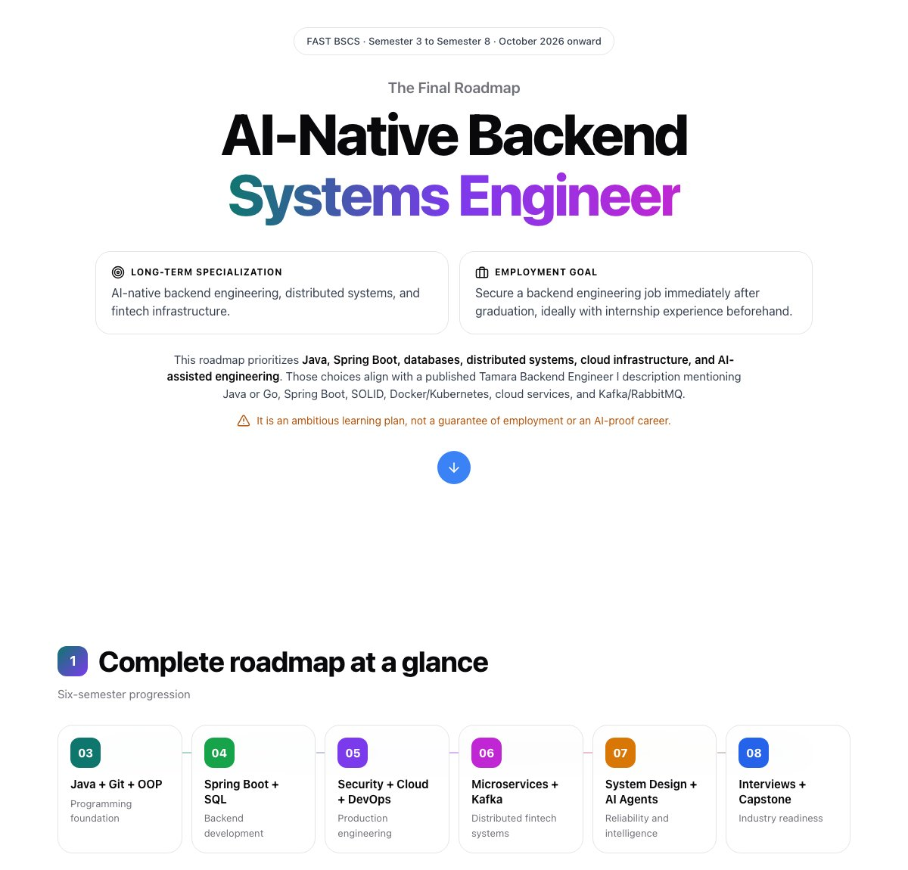
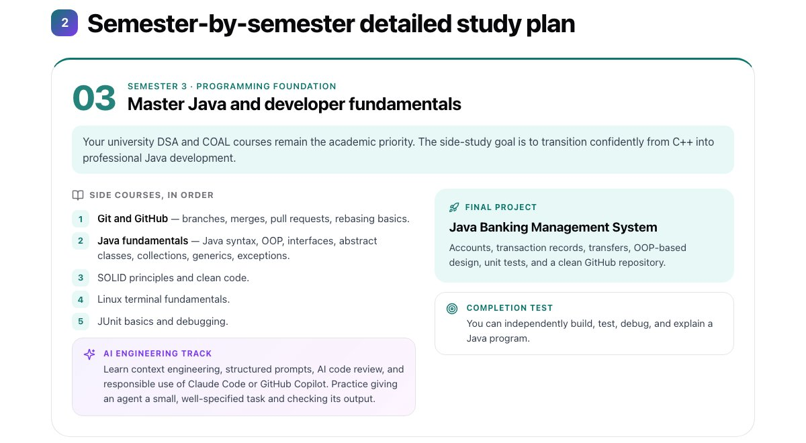
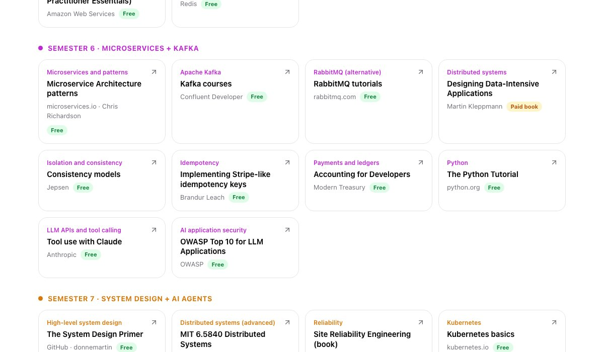

<div align="center">

# The Final Roadmap: AI-Native Backend Systems Engineer

**FAST BSCS · Semester 3 → Semester 8 · October 2026 onward**

My six-semester plan to go from C++ coursework to a job-ready backend engineer:
Java, Spring Boot, databases, distributed systems, cloud infrastructure and AI-assisted engineering.

### 🌐 [ubaidafzal01.github.io/Ai-native-backend-roadmap](https://ubaidafzal01.github.io/Ai-native-backend-roadmap/)



</div>

## 🧭 What's on the page

| # | Section | What's inside |
| --- | --- | --- |
| 1 | **Roadmap at a glance** | The six-semester progression, from *Java + Git + OOP* to *Interviews + Capstone* |
| 2 | **Semester-by-semester plan** | Side courses in order, an AI engineering track, a build-it-from-scratch final project with its YouTube guide, a completion test and career milestones for every semester |
| 3 | **Learning resources** | 53 hand-picked courses, books and docs, one primary resource per topic, each tagged *Free* or *Paid* |
| 4 | **Weekly study routine** | How 10 hours a week split across course work, projects, AI practice and revision |
| 5 | **Readiness checklist** | 10 target competencies to tick off, with a progress ring saved in your browser |
| 6 | **Tamara hiring consideration** | Why the plan is Tamara-targeted but not Tamara-dependent |
| ★ | **Final learning strategy** | 70% deep backend · 20% AI-native engineering · 10% career preparation, plus the guiding principle |



## 🗺️ The six semesters

| Semester | Focus | Final project | Project guide |
| --- | --- | --- | --- |
| **03** | Java + Git + OOP | Build Your Own Redis in Java | [Reinventing D Wheel](https://www.youtube.com/playlist?list=PLUtdCvEWBvma4DTjQdH5qCV4NIxqhOfDo) |
| **04** | Spring Boot + SQL | Write a Database from Scratch | [Code With Sep](https://www.youtube.com/playlist?list=PLWRwj01AnyEtjaw-ZnnAQWnVYPZF5WayV) |
| **05** | Security + Cloud + DevOps | Build Your Own Private Search Engine | [NetworkChuck](https://www.youtube.com/watch?v=ifT6npY39Dw) |
| **06** | Microservices + Kafka | Build Self-Learning AI Agents (Python) | [Dave Ebbelaar](https://www.youtube.com/watch?v=ynhl8KjjS3Y) |
| **07** | System Design + AI Agents | C++ Compiler in C++ | [lolzdev](https://www.youtube.com/watch?v=J-_yoKCxhYk) |
| **08** | Interviews + Capstone | Production-Grade Distributed Redis | Your Semester 3 project, grown up |



## ✨ Features

- **WebGL fluid ink background**: colourful ink follows your cursor or finger, the same effect as my portfolio
- **Glassmorphism design**: frosted-glass cards with a different accent colour for each semester
- **Interactive checklist**: progress is saved in `localStorage`, so your ticks survive a refresh
- **Floating section dock** that highlights where you are, plus smooth scroll-reveal animations
- **Responsive** down to phone width, and respects `prefers-reduced-motion`
- **No frameworks, no build step**: plain HTML, CSS and JavaScript

## 🚀 Run locally

```bash
git clone https://github.com/ubaidafzal01/Ai-native-backend-roadmap.git
cd Ai-native-backend-roadmap
python3 -m http.server 8000
```

Then open http://localhost:8000.

## 📁 Structure

```
├── index.html     # all roadmap content
├── style.css      # glass design, semester accents, responsive layout
├── script.js      # scroll reveal, dock, readiness checklist
└── fluid.js       # WebGL fluid simulation for the ink background
```

> This is an ambitious learning plan, not a guarantee of employment or an AI-proof career.

---

Made by **Ubaid Afzal** · [Portfolio](https://ubaidafzal01.github.io/Ubaid-Afzal/) · [GitHub](https://github.com/ubaidafzal01)
